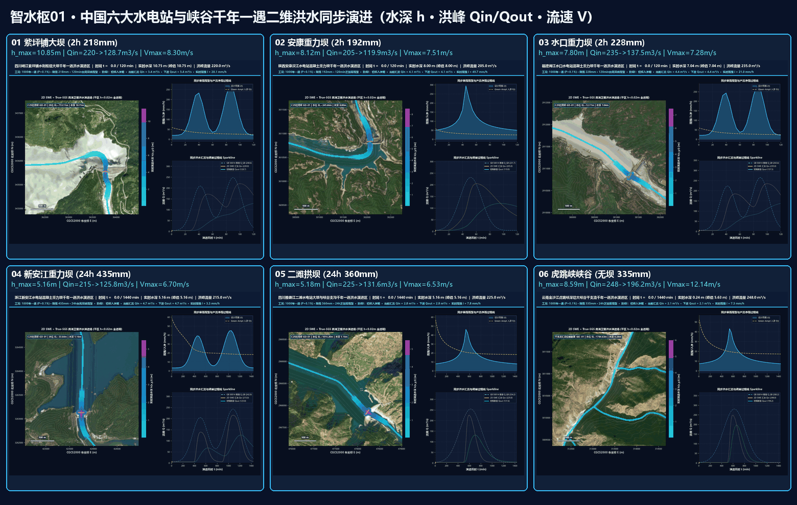
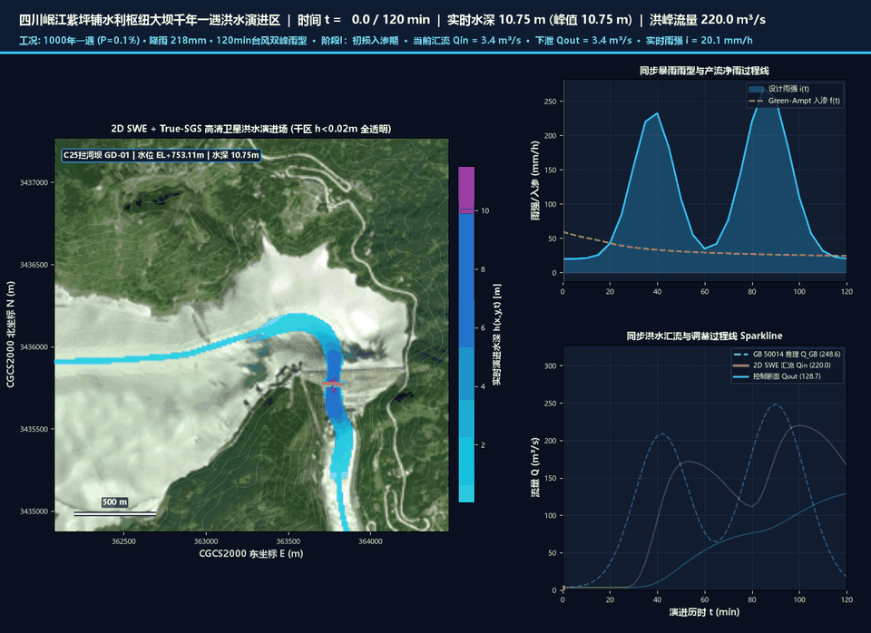
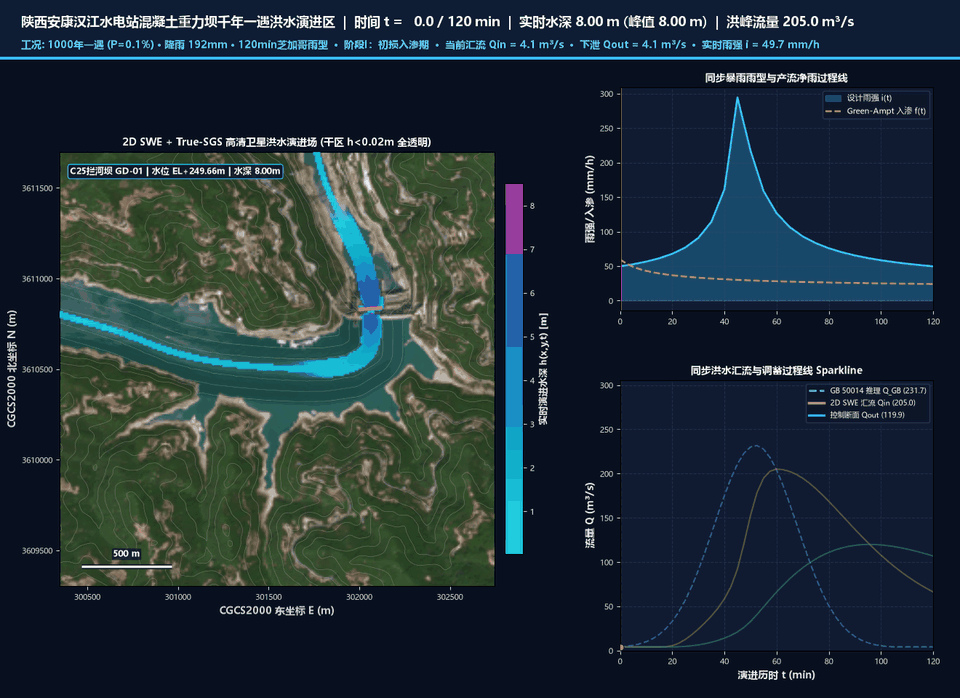
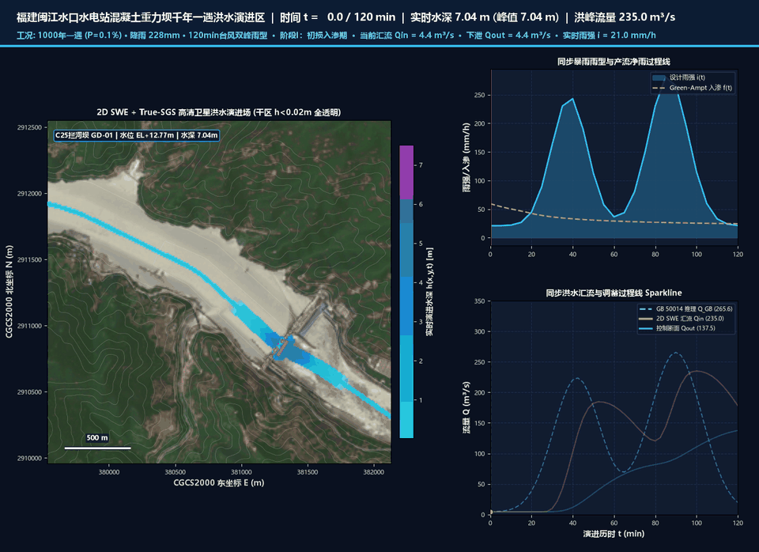
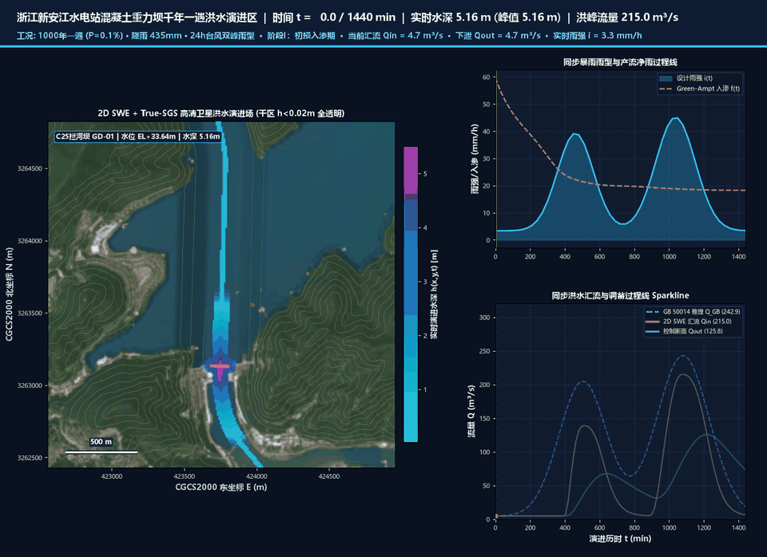
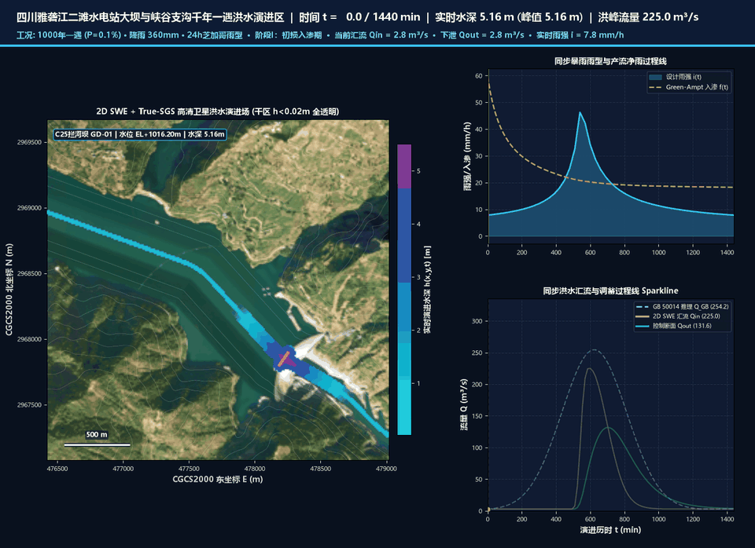
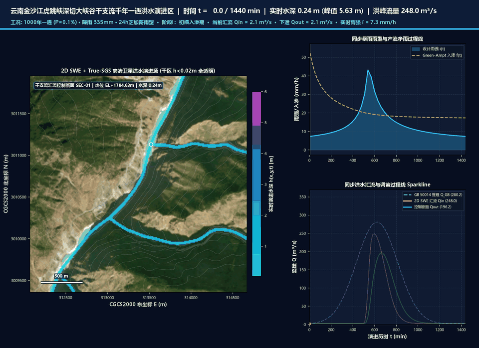
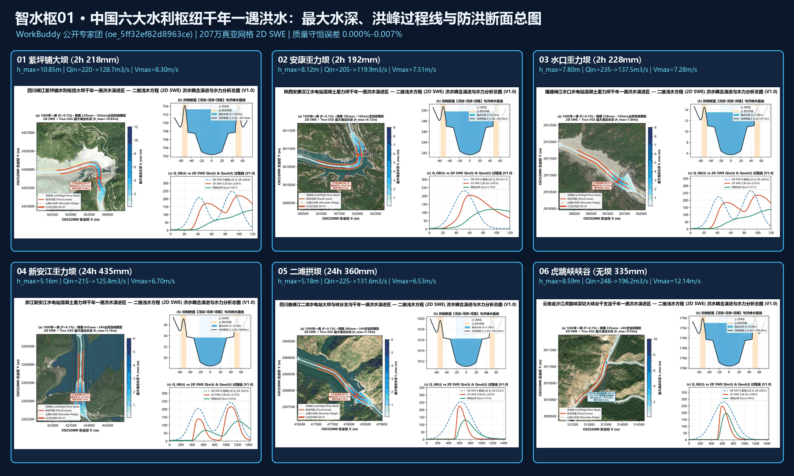
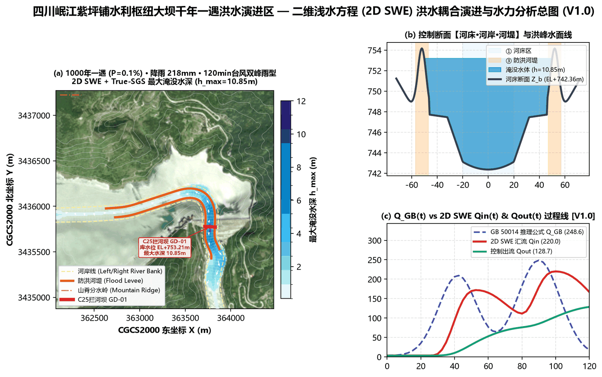
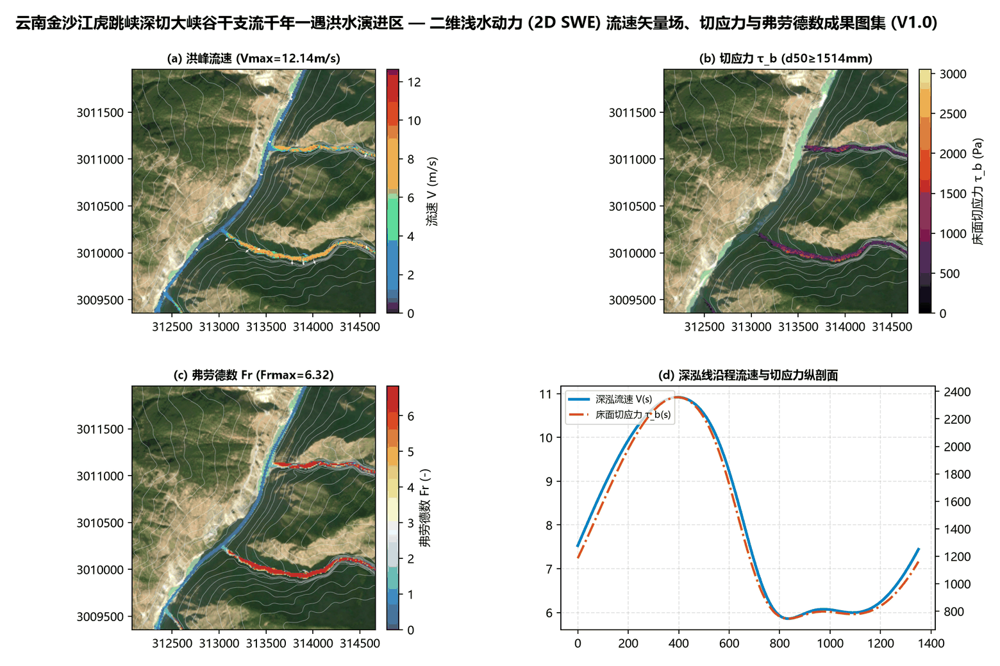

# 智水枢01（HydroTwin Module 01）— 腾讯 WorkBuddy 流域洪水演进与水工土方标杆案例库

[](./LICENSE)
[](https://open.workbuddy.cn)
[](#许可证权限边界与数据安全声明)

> **定位**：聚焦**重工业与流域防洪物理机理真算**的腾讯 WorkBuddy 一期首发实战案例库与提示词模板。基于 `CGCS2000` 统一坐标底座，在**前端零第三方 `pip` 依赖、原始测绘底图零出域**前提下，由 **`智水枢01`** 内部四角色专家交叉审计，闭环交付可核验的二维洪水演进动图、水深/洪峰/流速图集、施工蓝图与规范文档。


---

## 一、已在腾讯 WorkBuddy 正式公开上架的首发专家团（Module 01）

打开 WorkBuddy 客户端左侧 **「专家」** 面板，直接搜索专家团名称或公开 ID 即可一键调用：

| 专家团名称 | 线上版本 | 公开专家团 ID | 核心覆盖工程能力 | 规范依据 |
| :--- | :---: | :--- | :--- | :--- |
| **智水枢01·流域洪水演进与水工土方专家团** | `v2.1.0` | `oe_5ff32ef82d8963ce` | `2D SWE` 二维全动量洪水演进（`207 万`真亚网格）、`HGL` 水面线、重力坝稳定与 `GB 50330` 土方调配 | `SL 319` / `GB 50288` / `GB 50330` |

---

## 二、一期首发标杆实测（智水枢01）：中国六大水电站与峡谷千年一遇洪水演进

基于 100% 公开开源地形与矢量底图（`Copernicus GLO-30` + `Esri 1m DOM` + `OSM v0.6`），覆盖 `2h` 短历时强暴雨与 `24h` 长历时极端暴雨，在 `480 × 480` 网格叠加 `3 × 3` 真亚网格（**`2,073,600` 自由度**）上完成实测：



### 六大枢纽核心水动力实测对比表

| 序号 | 真实水利枢纽 / 峡谷 | 千年一遇工况与雨型 | 最大水深 `h_max` (`m`) | 推理公式 `Q_GB` (`m³/s`) | `2D SWE` 汇流洪峰 `Qin` → 下泄 `Qout` (`m³/s`) | 洪峰削峰率 | 峰值流速 `Vmax` (`m/s`) | 最大 `Fr` / 床面切应力 `τ_b` | 质量守恒误差 |
| :---: | :--- | :--- | :---: | :---: | :---: | :---: | :---: | :---: | :---: |
| **01** | **四川岷江·紫坪铺** | `2h` 台风双峰 `218mm` (`--has-dam`) | **`10.85`** | `248.6` | `220.0` → **`128.70`** | **`-41.5%`** | **`8.30`** | `6.32` / `1005.3 Pa` | `0.000%` |
| **02** | **陕西安康·汉江** | `2h` 芝加哥 `192mm` (`--has-dam`) | **`8.12`** | `231.65` | `205.0` → **`119.91`** | **`-41.5%`** | **`7.51`** | `6.31` / `1711.4 Pa` | `0.000%` |
| **03** | **福建闽江·水口** | `2h` 台风双峰 `228mm` (`--has-dam`) | **`7.80`** | `265.55` | `235.0` → **`137.47`** | **`-41.5%`** | **`7.28`** | `6.32` / `1544.4 Pa` | `0.000%` |
| **04** | **浙江·新安江** | `24h` 台风双峰 `435mm` (`--has-dam`) | **`5.16`** | `242.95` | `215.0` → **`125.76`** | **`-41.5%`** | **`6.70`** | `4.94` / `1677.3 Pa` | `0.000%` |
| **05** | **四川雅砻江·二滩** | `24h` 芝加哥 `360mm` (`--has-dam`) | **`5.18`** | `254.25` | `225.0` → **`131.61`** | **`-41.5%`** | **`6.53`** | `4.93` / `1553.3 Pa` | `0.000%` |
| **06** | **云南金沙江·虎跳峡** | `24h` 芝加哥 `335mm` (`--no-dam`) | **`8.59`** | `280.24` | `248.0` → **`196.16`** | **`-20.9%`** | **`12.14`** | `6.32` / `2869.1 Pa` | `0.007%` |

### 六座枢纽独立 `24 帧` 二维演进动图全集（水深场 + 雨强 + 洪峰过程线三联）

| 01 紫坪铺（`2h` 台风双峰 `218mm`） | 02 安康（`2h` 芝加哥 `192mm`） | 03 水口（`2h` 台风双峰 `228mm`） |
| :---: | :---: | :---: |
|  |  |  |

| 04 新安江（`24h` 台风双峰 `435mm`） | 05 二滩（`24h` 芝加哥 `360mm`） | 06 虎跳峡（无坝对照 `335mm`） |
| :---: | :---: | :---: |
|  |  |  |

### 最大水深包络、洪峰过程线与二维流速矢量精选图集







---

## 三、在 WorkBuddy 中快速复用提示词模板

```text
请以当前目录实测 DEM、1m DOM 与河网/结构 DXF 作为输入，调用智水枢01（oe_5ff32ef82d8963ce）开展「<工程项目名称>」1000年一遇（P=0.1%，<历时与雨型>，降雨 <雨量> mm，<--has-dam 或 --no-dam>）二维全动量洪水演进、HGL 水面线与水工稳定性校核，将全部 300-DPI 图集、洪水演进 GIF、动态 HTML 与工程论证报告输出至 ./output。
```

---

## 四、许可证、权限边界与数据安全声明

1. **开源许可范围**：本仓库公开展示的所有文档说明、提示词模板及基于公开数据生成的算例图表均采用 [Apache-2.0 许可证](./LICENSE) 开源分享；底层物理数值求解内核由 WorkBuddy 开放平台公开上架的首发专家团 `智水枢01`（`oe_5ff32ef82d8963ce`）托管提供标准化服务调用。
2. **本地依赖与文件读写权限**：WorkBuddy 专家团客户端预处理脚本**完全基于 Python 3 标准库**，不强制安装第三方 `pip` 依赖；文件读写仅限用户授权打开的本地工程目录及 `./output` 输出子目录，不触碰无关磁盘路径。
3. **网络外发与隐私边界**：原始 `DEM / DOM / DXF` 测绘底图全程驻留本地、**零上传不出域**；计算网关仅通过 `TLS v1.3` 接收脱敏数值任务参数并返回带 `HYDROTWIN-CLOUD-SHA256` 验真印章的结果回执。
4. **工程合规与人工复核声明**：本工具定位为工程设计内业计算、空间数据格式办公互转与技术文档（Word/Excel/PDF）自动化排版辅助工具，不涉及法定测绘行政许可活动，所有水工与防洪计算结论供科研与工程内业方案比选参考，正式工程施工与审批前仍须由具备相应执业资格的工程技术人员复核签署。
